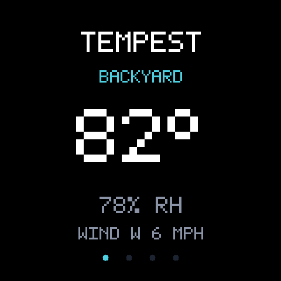

# Tempest for Zepp OS (Amazfit)

[](#)
[](https://github.com/josephwmi/tempest-watch/releases/latest)
[](#)

A watch app that shows live conditions from your own **WeatherFlow Tempest**
personal weather station: temperature, feels-like, humidity, dew point, wind and
gust, pressure and trend, UV, solar, rain today and lightning.

- Watch UI: `page/index.js` (Zepp OS API_LEVEL 3.0+, `@zos/ui`) — runs on round and square Zepp OS watches; the layout comes from `page/metrics.js` and scales to the real screen size
- Phone side service: `app-side/index.js` — all HTTP happens here, because the
  watch itself has no internet
- Settings page: `setting/index.js` — where you enter the station ID
- Mapping and unit conversion: `utils/format.js` (pure JS, unit tested)
- Tests: `npm test` (24 tests, no watch needed)

## How it works

```
Watch app  ──request──▶  app-side (phone, in the Zepp app)
                                │  GET https://swd.weatherflow.com/swd/rest/observations/station/<id>?token=<token>
                                ▼
                          Tempest cloud  ──▶  latest observation (SI units)
                                │
        ◀──mapped view model────┘  (F/mph/inHg/in or C/m/s/hPa/mm)
```

- The last good reading is cached in the phone's settings storage, so opening the
  watch app is instant and a dropped connection shows the old numbers rather than
  an empty screen.
- A fetch is only made if the cache is older than 60 seconds; the middle button on
  the watch forces one.
- Errors are shown as words on the watch: no station set, token rejected, station
  not found, no reading, no connection.

## Screens on the watch

Swipe or tap `<` / `>` to page through four screens; the dots at the bottom show
which one you are on.

| Page | Big number | Under it |
|---|---|---|
| 1 Temperature | current temp | feels-like + comfort word |
| 2 Wind | average wind | direction (cardinal + degrees), gust |
| 3 Air | humidity | dew point, pressure + trend |
| 4 Sun & rain | UV index | rain today, lightning in the last hour or solar |



*(Layout sketch of page 1 — the real app draws these with the watch's own fonts.)*

## Install in one tap on the watch

The package is published as a public GitHub release, so there is nothing to host:

- Release: <https://github.com/josephwmi/tempest-watch/releases/tag/v2.1.0>
- Package: <https://github.com/josephwmi/tempest-watch/releases/download/v2.1.0/tempest-watch-balance2.zab>
- QR: `docs/install-qr.png`

Zepp app › Profile › your watch › Developer Mode › QR scanner, and scan that
image. Full walkthrough: **[docs/INSTALL.md](docs/INSTALL.md)**.

## Install on the watch

If the QR scanner refuses the package, use **[docs/INSTALL-ALT.md](docs/INSTALL-ALT.md)**
(Bluetooth via `npx zeus preview`).

Step-by-step, including the QR code: **[docs/INSTALL.md](docs/INSTALL.md)**.
The short version: turn on developer mode (seven taps on the Zepp logo), put the
`.zab` at a public https URL, `node scripts/make-qr.cjs <that URL>`, then scan
`docs/install-qr.png` with the watch's QR scanner.

## Setup

1. In the Zepp app: **Profile › your watch › App settings › Tempest**.
2. **Station ID** — digits only, from tempestwx.com › Settings › Stations
   (a pasted station URL also works; the app pulls the number out).
3. **Token (optional)** — tempestwx.com › Settings › Data Authorizations › Create
   Token. Not needed for a plain station-id lookup; useful if WeatherFlow asks for
   authenticated access or you later add OAuth.
4. Pick **imperial** or **metric**.
5. Tap **Test connection** — it should come back with your station name and a
   reading.

## Build and install

```bash
npm install
npm test          # 24 tests: mapping, side service, settings page, layout on every screen size
npx zeus build    # writes dist/1138029-Tempest-2.1.0-<timestamp>.zab
```

Install on the watch, either way:

- **Zepp app Developer Mode** — Profile › Settings › About, tap the Zepp logo seven
  times; then Profile › your watch › Developer Mode › QR scanner, scanning a QR for
  a `zpkd1://` link to the `.zab` file.
- **Zeus CLI** with the watch bridged: `npx zeus preview` (or `zeus install` for the
  built `.zab`).

## Supported watches

The build has one target (`default`) with two screen types (`app.json` › `targets.default.platforms`), and requires API_LEVEL 3.0 or higher (`runtime.apiVersion.minVersion`). 3.0 is the minimum for the ZML library the app is built on (`@zeppos/zml`).

| Screen | Watches (from the [Zepp OS device list](https://docs.zepp.com/docs/reference/related-resources/device-list/)) | Assets |
|---|---|---|
| Round 480 x 480 | Balance 2, Balance 3, Balance Ultra, Balance, T-Rex 3, T-Rex 3 Pro 48 mm, T-Rex Ultra 2, Cheetah Pro, Cheetah 2 Ultra, Active Max | `assets/default.r` |
| Round 466 x 466 | Active 2 (round), Active 3 Premium, GTR 4, Cheetah 2 Pro, T-Rex 3 Pro 44 mm | `assets/default.r` |
| Round 454 x 454 | Cheetah (round), T-Rex Ultra | `assets/default.r` |
| Round 416 x 416 | Falcon | `assets/default.r` |
| Round 360 x 360 | Active Edge | `assets/default.r` |
| Square 390 x 450 | Active, Active 2 (square), Bip 6, GTS 4, Cheetah (square) | `assets/default.s` |
| Square 432 x 514 | Bip Max: runs in its 390 x 450 compatibility mode, centred on the screen | `assets/default.s` |
| Square 320 x 380 | Bip 5 Unity | `assets/default.s` |

These watches are **not** supported, because their firmware is below API_LEVEL 3.0 or has no API_LEVEL at all: Bip 5, GTR Mini, T-Rex 2, GTR 3 / GTR 3 Pro, GTS 3, GTS 4 mini and Band 7.

How the layout adapts: `page/index.js` reads the real width, height and shape from `getDeviceInfo()`. `computeLayout()` in `page/metrics.js` then scales one reference design per shape to that size: 480 x 480 for round screens and 390 x 450 for square ones, which are Zepp's own design benchmarks. Positions follow the screen's width and height separately, and fonts scale by the smaller of the two. `npm test` checks the layout at every resolution in the table above: every widget must stay on screen, buttons must stay inside the round face or the square screen's rounded corners, and the buttons must not overlap. On a 480 round screen (Balance 2) the layout is the same as before, apart from narrower title margins and a wider gap between the three buttons, which previously overlapped.

`npx zeus build` (Zeus CLI 1.10, run 2026-11-24) writes one `.zab` with 12 per-device packages: round 360, 416, 454, 466 and 480, and square 320 x 380, 390 x 450 and 432 x 514, each for the CPU platforms Zeus knows.

The release file keeps its old name, `tempest-watch-balance2.zab`, so existing links and QR codes still work. The v2.0.0 package was built for round screens only. From v2.1.0 the package is built from this code with `npx zeus build`, and that one package contains both the round and the square build.

## Notes and limits

- Tempest's observation endpoint returns SI units only; the station's own unit
  preference comes back separately in `station_units`, so `utils/format.js` does
  the conversion itself.
- The observation endpoint has no sky-condition text ("partly cloudy"), so the
  one-line condition at the top is derived from rain, lightning, solar and UV.
- App ID `1138029` is the app ID registered in the Zepp developer console; the package,
  the console entry and this README must always agree. Change it in one place
  only — `app.json` — and rebuild.
- This is a personal-use client. WeatherFlow's remote data access policy expects
  third-party apps to read the station owner's own data; if you ever publish it
  for other people's stations, use their OAuth flow instead of a personal token.

---

## Version and release

Current version: **2.1.0** (`app.version` in `app.json`).
Latest release: <https://github.com/josephwmi/tempest-watch/releases/latest>

When you cut a new version, bump `app.version.code` and `app.version.name` in
`app.json`, then run `node scripts/release-notes.cjs` to print the version lines
this README should carry. That script reads `app.json` rather than trusting these
words, so the README can be checked instead of hoped for.

## Support screen

The fifth screen is a static thank-you that reads exactly: "Thanks for downloading this app! To donate: CashApp: $JosephWMI". Nothing is locked and there is no payment code in the app. KiezelPay was removed in v2.0.0.